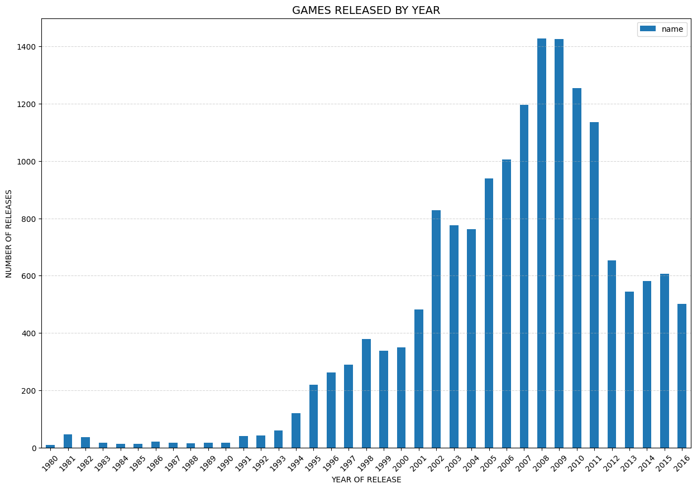
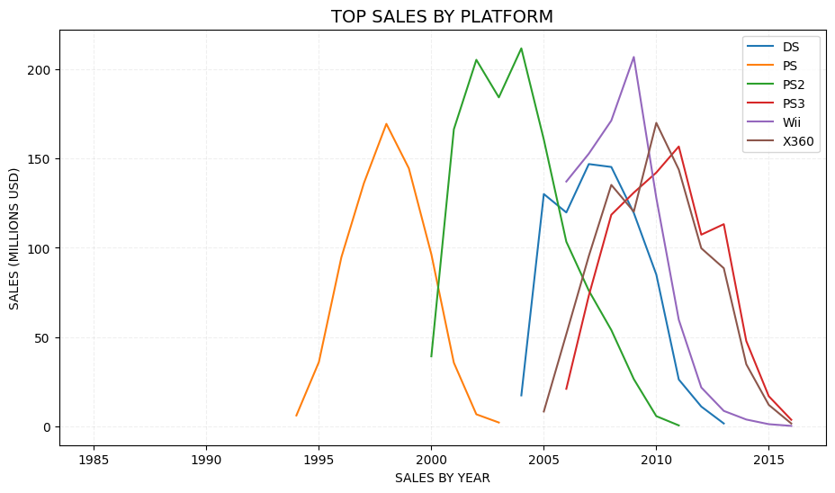
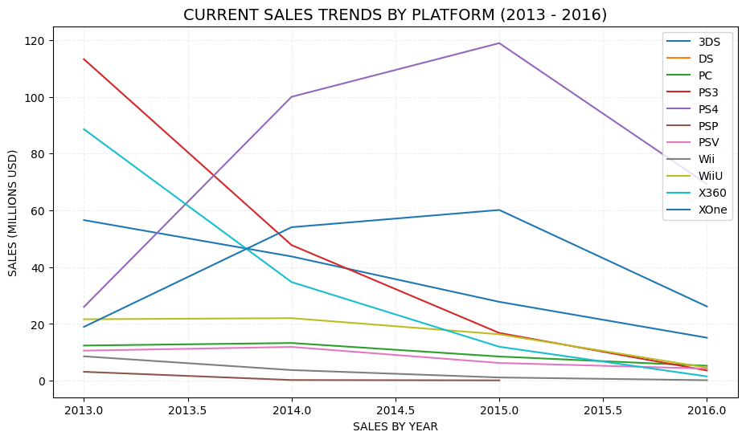
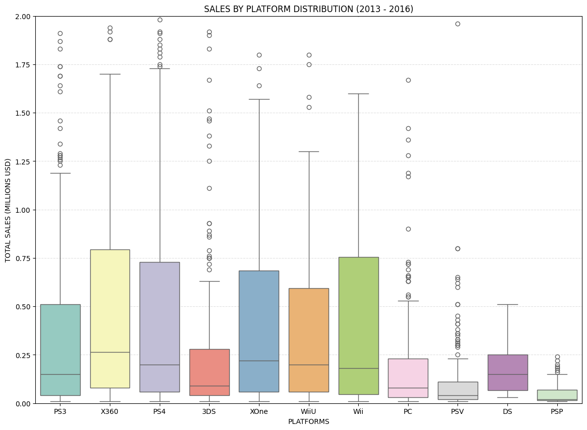
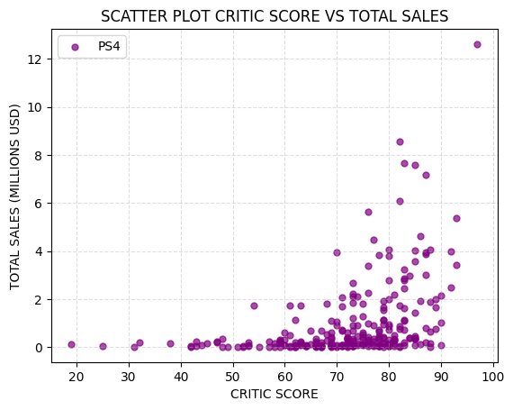
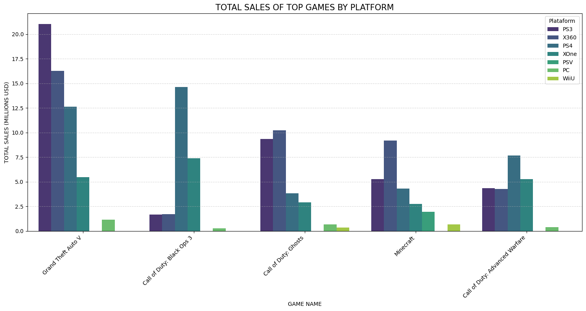

# About me

Certified financial and data analyst with strong experience in data extraction, cleaning, and strategic modeling.

I generate actionable insights that optimize processes and support strategic decision-making, achieving significant time savings through automation.

## Technical Skills

* Data analysis and management using **Excel / SQL / Python**
* Data visualization and storytelling using **Power BI**

## Soft Skills

Data Analysis | Problem Solving | Effective Communication | Teamwork | Results-Oriented | Organization | Proactivity | Attention to Detail | Process Optimization

<a href="https://www.linkedin.com/in/rafael-malez-data-analyst/" target="_blank" style="background-color: #1f4e78; color: white; padding: 10px 20px; text-decoration: none; font-weight: bold; border-radius: 4px; display: inline-block; margin-right: 10px;">LINKEDIN</a>
<a href="mailto:malezrafael@gmail.com" style="background-color: #1f4e78; color: white; padding: 10px 20px; text-decoration: none; font-weight: bold; border-radius: 4px; display: inline-block;">MICROSOFT OUTLOOK</a>

---

---

# Featured Project

### 🚗 Automotive Market Interactive Dashboard

The primary goal of this project is to practice software engineering best practices, data manipulation, and web application development by building a fully functional and deployed web app using a used car sales dataset.

### Tools and Project Type

  
  
  
  
  
  
  

  
  
  

### Key Questions

1. How are vehicle prices distributed across the platform's listings?
2. What is the relationship between a vehicle's mileage (odometer) and its listing price?
3. How can interactive filters and charts help users explore vehicle market trends efficiently?

### Methodology

* **Environment Setup & Preprocessing:** Configured Python virtual environments, managed dependencies via `requirements.txt`, and ensured dataset integrity.
* **Exploratory Data Analysis (EDA):** Performed initial data analysis inside Jupyter Notebooks (`EDA.ipynb`) using Pandas and Plotly Express to identify core market patterns.
* **Interactive Web App Development:** Built a web application using Streamlit (`app.py`), integrating interactive checkboxes and dynamic visual components.
* **Cloud Deployment:** Deployed the application to production on Render and maintaining continuous integration with the GitHub repository.

### Conclusions and Recommendations

#### Critical Market Insights:
* **Price Distribution:** Most listings are concentrated in the lower-to-mid price range (peaking around $15,000), with supply declining rapidly as prices rise and being dominated by accessible economy cars.
* **Depreciation Trend:** The scatter plot demonstrates a clear inverse relationship between mileage and price—vehicles with higher odometer readings exhibit a significant drop in market value. Most standard market vehicles cluster under 200,000 miles and $50,000.
* **Outliers:** Isolated extreme values (such as prices near $375,000 or mileages near 1,000,000) reflect data entry anomalies or specialized commercial vehicles.

#### Recommended Strategies:
* **Smart Budgeting:** Target vehicles with moderate mileage under the market density cluster to maximize value for money.
* **Data Quality Enhancement:** Implement automated validation rules on listing entry forms to filter out extreme pricing and mileage outliers.

### Links

* **Live Application:** [View Live App on Render](https://proyecto-s7-rm.onrender.com)
* **Source Code:** [GitHub Repository](https://github.com/RAFAMALEZ/proyecto_s7_rm)

---

---

### Featured Project

#### 🎮 Global Video Game Market Analysis (Ice Store Campaign 2017)

Conducted data-driven market research and predictive analysis to identify global trends, platform lifecycles, and regional preferences to inform strategic advertising planning.

### Tools and Project Type

  
  
  
  
  
  
  

  
  
  

### Project Overview
Working for the online store **Ice**, the objective was to identify patterns determining game success to optimize advertising campaigns and inventory planning for 2017 using historical data up to 2016.

### Methodology & Key Findings

#### 1. Historical Release Trends
An analysis of game releases across decades shows an exponential boom peaking in 2008–2009 (>1,400 releases), followed by a significant decline as the industry transitioned to Free-to-Play (F2P) models. Data prior to 2013 was filtered out to avoid obsolescence bias.

#### 2. Platform Lifecycles & Current Trends
Historical sales show that legacy hardware (PS2, Wii, Xbox 360) experiences an average lifecycle of ~10 years before sales drop to zero. For the 2017 campaign, eighth-generation platforms (**PS4** and **Xbox One**) represent the primary drivers of profitability.

#### 3. Global Sales Distribution (Boxplot Analysis)
Global sales distributions exhibit positive skewness driven by blockbuster hits. Consoles like Xbox 360, PS4, and Xbox One show higher volatility and greater potential reward, while PC and 3DS offer stable, lower-risk distributions.

#### 4. Impact of Reviews on Sales (PS4 Case Study)
A scatter plot analysis reveals a **moderate positive correlation** ($r \approx 0.4$) between critic scores and sales, whereas user scores show negligible correlation. Top-tier commercial success requires high professional ratings (>80), but scores alone do not guarantee blockbuster volumes.

#### 5. Multiplatform Blockbuster Performance
Top-selling titles concentrate their revenue heavily in Sony and Microsoft ecosystems, with consumer preference leaning heavily toward PlayStation hardware.

### Statistical Hypothesis Testing
To validate platform and genre assumptions, two-sample independent t-tests (`scipy.stats.ttest_ind`) were conducted using a significance threshold &alpha (α = 0.05):
* **Xbox One vs. PC User Ratings:** Tested whether mean user ratings are equal (H₀).
* **Action vs. Sports Genre Ratings:** Tested whether mean user ratings differ (H₁).

### Strategic Recommendations for 2017 Campaign
1. **Focus on Dominant Hardware:** Direct western advertising budgets primarily toward PS4 and Xbox One; phase out legacy platforms.
2. **Regional Localization (Japan):** Tailor Japanese market campaigns specifically toward portable consoles (Nintendo 3DS) and Role-Playing games, as western strategies fail in Asia.
3. **Inventory Strategy:** Prioritize consistent high-yield genres like **Shooters** to maximize return on investment and minimize storage risk.

### Links
* **Source Code & Notebook:** [GitHub Repository](https://github.com/RAFAMALEZ/tu-repositorio-proyecto-ice)
